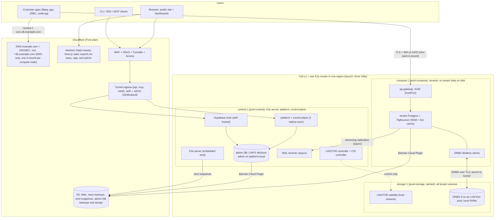
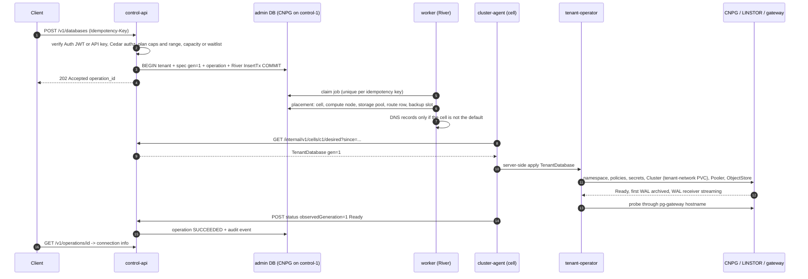
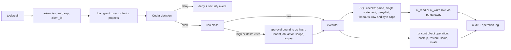

# 01 — Architecture (Blueprint 4.0)

Status: production architecture, revised 2026-10-07. This revision brings:
- **Three node roles:** `control-1`, `storage-1` and `compute-1`.
- **Separated storage:** tenant volumes on LINSTOR/DRBD storage nodes, diskless compute.
- **Self-hosted control-plane data:** the admin DB and Auth run on `control-1`.
- **Compute autoscaling** inside user caps.
- **High availability still deferred.**

Blueprint 4.0 returns to **K3s**, the original PDF's choice: a CNCF-certified Kubernetes distribution shipped as a single binary, pinned to `v1.36.4+k3s1`. Local development runs the same release in Docker with k3d, plus small QEMU/KVM VMs for the storage engine (`04-…` Step 0.3b). We don't run kubeadm-built upstream Kubernetes or a managed Kubernetes service; "Kubernetes" in this document means the API and its ecosystem.

The design is **provider-neutral**: cells run on plain Linux VMs from any provider that passes the checklist in `03-cost-model.md` §2. The launch provider is Hostinger India, accepted only if spike S12 passes (ADR-029). The PDF's product rules (tenant model, invariants, MCP permission model, acceptance gates) still apply. Costs and capacity numbers live in `03-cost-model.md`.

---

## 0. One-paragraph summary

Customer PostgreSQL databases run on **our own machines**: a **cell** is one K3s cluster in one region. The launch cell has **three node roles** (ADR-029):
- **`control-1`** is the single K3s server (embedded etcd). It runs the whole platform and control plane, including the self-hosted **admin DB** (CloudNativePG) and **Supabase Auth** (ADR-028).
- **`storage-1`** holds every tenant volume on local NVMe through **LINSTOR + DRBD 9** (ADR-027).
- **`compute-1`** runs only tenant Postgres, PgBouncer and the Rust **pg-gateway**. It keeps no tenant data on its disk: each volume is a DRBD *diskless* client, and the compute node's RAM is the hot cache.

Users pick a compute range inside their plan's caps, and a **compute governor** scales memory inside it without restarts (ADR-030). **R2** holds the continuous WAL archive and base backups (7-day PITR), and a streaming WAL receiver on `control-1` keeps the newest WAL off the storage node (ADR-031).

The control plane never stores or proxies customer rows. Cloudflare's free plan fronts all HTTP traffic (Tunnel, WAF, Access, Turnstile, the Next.js static site and dashboards) and serves DNS. Customer Postgres traffic never passes through Cloudflare's proxy; clients connect straight to the gateway on the compute nodes' public IPs.

The platform costs ≤ ₹9,000/month (≈ ₹8,067 at renewal prices, `03-…` §1). Growth adds compute and storage nodes, bigger nodes, then cells (on the same or another provider, including AWS later) with the same code; each paid step is taken only when revenue already covers it. High availability is designed but deferred.

---

## 1. Invariants and reliability targets

1. One CloudNativePG `Cluster` + one customer database per tenant. The Pod is the compute boundary; the database is the data boundary.
2. Writes for one database are never spread across clusters or providers. Horizontal scale = more nodes, more cells, tenant migration.
3. The control plane never stores or proxies customer data. The admin DB holds only our management metadata.
4. **Static stability:** the data path survives control-plane loss. If `control-1` (K3s API, control plane, admin DB, Auth) or Cloudflare's proxy, Tunnel or API is down, running customer databases keep serving traffic; only changes (create/scale/restore) and sign-in wait. A compute node keeps serving while `control-1` is down because DRBD replication is kernel-to-kernel between the compute and storage nodes, and the gateway serves from its route cache. Losing a storage node stops the volumes on it until it returns or the tenants restore. Database hostnames are DNS-only records in Cloudflare DNS; during an authoritative-DNS outage, clients keep working from cached answers for the record TTL.
5. All changes are asynchronous, idempotent, retry-safe and audited.
6. Customers and AI agents never receive Kubernetes, VM, R2 or admin-DB credentials.
7. No availability promise for a tier until its acceptance gate passes on the real deployment.
8. **Spend is capped** at ₹9,000/month (`03-…` §1). Nothing billable is created unless the build-plan step and the cost model say so.
9. **Provider-neutral:** nothing in code or manifests depends on one VM provider. Provider-specific pieces live only in `deploy/terraform/modules/vm-<provider>` and the provider adapter.

**About "100 % reliability":** no system achieves it, and promising it would be false. The design removes single points of failure step by step and publishes measured targets:

| Tier | Target availability (after gates pass) | RPO | RTO |
|---|---|---|---|
| `base` (single instance, volume on a storage node) | best effort, 99.5 % goal | < 1 s typical (WAL receiver); ≤ 5 min worst case (R2 archive) | compute-node loss ≈ 1–2 min with a second compute node; storage-node loss set from the storage-loss drill |
| `plus`, `premium` (single instance, volume on a storage node) | best effort, 99.5 % goal | < 1 s typical; ≤ 1 min worst case | as `base` |
| HA (Phase 3: primary + replica, volumes on different storage nodes) | 99.9 % | 0 (sync option) – ≤ 1 min | ≤ 1 min (failover) |
| HA + DR (Phase 4: replica cell in another region) | 99.9 % + region survival | ≤ 1 min cross-region | ≤ 30 min region failover |

What survives what, on the three-role launch cell:
- **A crashed pod or a K3s restart:** the pod restarts in seconds; restarting K3s leaves running containers alive, so tenant databases keep serving.
- **`control-1` lost:** running databases keep serving (static stability above); changes, sign-in, dashboards, metrics and the WAL receiver stop. A replacement `control-1` is bootstrapped, K3s is restored from the latest etcd snapshot in R2 (the LINSTOR controller keeps its state in Kubernetes objects, so it comes back with it), and the admin DB restores from its R2 bucket (runbook `RestoreControlNode`).
- **A compute node lost:** with a second compute node, the fencer confirms the VM is off and its tenants restart on the other compute node in ≈ 1–2 min with no data loss (§7.5). With one compute node, its tenants wait for the VM to come back.
- **A storage node lost:** the volumes on it are down until it returns. If it is gone for good, its tenants restore from R2 plus the WAL receiver onto another storage node (RPO < 1 s typical, worst case the plan's `archive_timeout`); the RTO is measured in the storage-loss drill (`04-…` Step 1.10).
- **The whole provider region:** tenants restore from R2 into a new cell (`RebuildCell`).
- **With high availability (deferred, `04-…` "Deferred (not scheduled): high availability"):** any one VM can be lost. The control plane keeps quorum (2 of 3 etcd members), the platform keeps running (2 replicas per stateless service), and two diskful copies plus a DRBD tie-breaker keep every volume available with RPO 0.

---

## 2. Topology



"Platform" = control-api, worker, mcp-server, mcp-auth, tenant-operator, cluster-agent, River UI, cloudflared, observability, Flux, cert-manager, the CNPG operator and the Piraeus/LINSTOR controllers, one replica each on `control-1` (§5.2). Adding nodes:
- **A compute node** adds its own pg-gateway, tenants and A record.
- **A storage node** adds pool capacity and a target for online volume moves.
- **High availability (deferred)** adds `control-2` and `control-3` as servers and a second platform replica per service.

The control plane is stateless apart from the admin DB, so it runs inside the cell on `control-1`. From Phase 4 it runs **active-active in two cells**: each cell has its own tunnel, and Cloudflare Load Balancing (paid add-on, bought when Phase 4 is funded) spreads `api.`/`mcp.`/`oauth.` across both.

### 2.1 Layers and boundaries

| Layer | Runs on | Responsibility | Hard boundary |
|---|---|---|---|
| Edge | Cloudflare Free | DNS, WAF, DDoS, bot checks, Access for staff, static web apps, HTTP and admin tunnel | No public HTTP or SSH on the VMs; Postgres never proxied |
| Control plane | Go services on `control-1` | AuthN/Z, catalog, placement, capacity, fencing, operations, billing, MCP | Admin metadata only |
| Admin DB + Auth | CNPG `dbcloud-admin` + self-hosted Supabase Auth on `control-1` | Durable state of the control plane, job queue, user identity | Reached only from inside the cell (NetworkPolicy); Auth only through the Tunnel |
| Cell data plane | compute nodes (Postgres, PgBouncer, gateway) + storage nodes (LINSTOR/DRBD) | Tenants' PostgreSQL, poolers, gateway, tenant volumes | Default-deny network, restricted Pod Security, encrypted node-to-node traffic, no tenant data on compute disks |
| Recovery plane | R2 + the WAL receiver on `control-1` (+ a second cell in Phase 4) | WAL archive, base backups, etcd snapshots, admin-DB backups and dumps, newest WAL off the storage node | Restore-tested before RPO/RTO is published |

---

## 3. Language split

| Component | Language | Why |
|---|---|---|
| `pg-gateway` (Postgres TLS/SNI router on the data path) | **Rust** (tokio, rustls, kube-rs) | Every customer connection passes through it. No GC pauses, low memory per connection, memory safety for an internet-facing TLS terminator, precise control of the Postgres handshake. Same choice as Neon's proxy. |
| control-api, worker, cluster-agent, provider adapters, compute governor, WAL receiver controller | **Go** | Kubernetes SDKs are Go-native; River is Go; one toolchain |
| tenant-operator | **Go** (controller-runtime) | CloudNativePG and the operator ecosystem are Go |
| mcp-server | **Go** (official MCP Go SDK) | Supports MCP spec 2026-07-28 |
| mcp-auth | **Go** (zitadel/oidc, OpenID-certified library) | Standards-heavy, security-sensitive; use a certified protocol library |
| CLI `dbcloud` | **Go** (cobra) | Single static binary for every OS |
| Web apps: public site, customer dashboard, admin dashboard | **TypeScript** (Next.js 16 App Router, **static export**) | Built to static files and served free from Cloudflare Workers Static Assets; no server code, so none of Next.js's server-side vulnerabilities apply |

Rule: Rust only where the process sits on the per-connection data path. Everything else on the backend is Go. Every backend component ships as a multi-arch (`linux/amd64` + `linux/arm64`) container image built with Docker Buildx and stored in ghcr.io; K3s runs the images with containerd. The web apps ship as static files.

---

## 4. Provider, region and network

### 4.1 Provider

- Every provider is checked against the VM checklist (`03-…` §2.1): India region or ≤ 70 ms from Indian users, KVM-class virtualization, local NVMe for storage nodes, a public IPv4 per VM, enough included transfer (or priced egress), a predictable price, and the disk, network and CPU numbers of spike S12.
- **Launch: Hostinger India (Mumbai)**, `control-1` KVM 2, `storage-1` KVM 8, `compute-1` KVM 4 at ₹7,997/month renewal (ADR-029, `03-…` §2.2). It is accepted only after spike S12 passes inside the 30-day money-back window.
- **Hostinger constraints the design absorbs** (`03-…` §2.2):
  - no add-on disks, and KVM 8 (400 GB) is the top plan;
  - one public IPv4 and no documented private network, a recorded deviation from checklist item 4;
  - a monthly transfer cap with a 10 Mbps throttle when it is exceeded;
  - CPU credits with a 30 % baseline;
  - no nested virtualization.
- **Fallback:** DigitalOcean BLR1 as a 2-node design (free VPC, Volumes up to 16 TiB). **Later big-database cell:** AWS Mumbai (gp3 volumes up to 64 TiB, §4.3).
- A cell never spans providers or regions: K3s supports embedded etcd only with all servers in one location, and cross-provider traffic is slow, fragile and billed (`03-…` §2.3). Another provider or region becomes a **separate cell** later.

### 4.2 Network per cell

| Network | Addresses | Contents |
|---|---|---|
| Node addresses | the provider's private network where one exists (for example 10.20.0.0/24); on Hostinger, each VM's public IPv4 | K3s API, kubelet, WireGuard (flannel), Spegel, LINSTOR and DRBD traffic, all encrypted and allow-listed by peer IP |
| Pod network (flannel) | 10.42.0.0/16 (K3s default) | pod IPs, /24 per node |
| Service network | 10.43.0.0/16 (K3s default) | ClusterIPs |
| Public IPv4 per VM | provider-assigned (static) | compute nodes: TCP 5432 open to the internet; `control-1` and storage nodes: nothing open to the internet |

- **flannel `wireguard-native`** between the node addresses: pod-to-pod traffic between nodes (gateway → tenant Postgres, WAL streaming to the receiver, backups) is encrypted even when it crosses a public interface.
- **Storage traffic** runs on the host network, outside flannel. DRBD replication uses **DRBD TLS through kernel TLS (kTLS)**, with a `tlshd` sidecar on each LINSTOR satellite (DRBD ≥ 9.2.6). LINSTOR controller ↔ satellite traffic uses TLS with certificates from cert-manager. `nvmet-tcp` is never exposed.
- **Firewall:** a provider firewall where available, plus nftables on every VM, both from code.
  - **From the internet:** only TCP 5432 on compute nodes.
  - **Between nodes, from peer node IPs only:** 6443 (K3s API, to `control-1`), 10250 (kubelet), 51820–51821/udp (WireGuard), 5001 (Spegel), 3366–3367 (LINSTOR satellite API, TLS on 3367) and the DRBD port range 7000–7999; 2379–2380 (etcd) only between servers once HA exists.
  - **No public SSH and no public K3s API:** admins reach both through Cloudflare Tunnel + Access (§11). The provider's web console is the break-glass path.
- **Transfer:** without a private network, VPS-to-VPS traffic may count against Hostinger's monthly transfer cap; S12 measures it and asks support in writing. Bulk flows are shaped (DRBD resync `c-max-rate`, backup and egress shaping), and transfer alerts fire at 70 % of each VM's allowance (§17).
- **Egress:** each VM egresses from its own public IPv4.
- **Cloud metadata endpoints** (169.254.169.254 on many providers) are blocked for pods by NetworkPolicy (`ipBlock` `0.0.0.0/0` with `except` for private, link-local and metadata ranges) in every namespace; no workload uses instance credentials.
- **IPv6:** K3s fixes the IP families at cluster creation. The cell is created **IPv4-only**; a later cell can be dual-stack if its provider supports it end to end.

### 4.3 AWS mapping (for a later AWS cell)

- `deploy/terraform/modules/vm-aws` (EC2) creates only the VMs, a security group mirroring the nftables rules, a static public IP per compute node and the disks. For storage nodes, the disks are gp3 volumes attached by Terraform; LINSTOR puts its pool on them, which raises the per-database ceiling to the volume size (up to 64 TiB). Everything else is the same bootstrap, K3s config, Flux and Helm as on any provider.
- Not used: the EBS CSI driver, ELB/NLB, Secrets Manager or KMS for workloads, and IAM instance profiles. IMDSv2 is required with a hop limit of 1, and NetworkPolicy already blocks 169.254.0.0/16 for every pod (ADR-018).
- A `ProviderAdapter` implementation named `aws` adds and removes nodes for the capacity controller and powers the fencer (§10.4), with a narrowly scoped key held only by the worker.
- R2 stays the backup target. Uploads from AWS to R2 are AWS internet egress, billed per GB beyond the free 100 GB/month; `03-…` §8 gives the volume (≈ 4.96 × db per month).
- Every image is multi-arch (spike S6), so Graviton (arm64) instances work.

---

## 5. Cells (K3s clusters)

### 5.1 Cluster settings

- **K3s `v1.36.4+k3s1`** (v1.36 stable channel, pinned exactly), tracking Kubernetes 1.36, which CloudNativePG 1.30 supports. K3s is a CNCF-certified Kubernetes distribution; CNPG officially targets vanilla Kubernetes, so spike S1 runs the Kubernetes conformance suite and the CNPG e2e smoke tests on the pinned K3s.
- OS: Ubuntu 24.04 LTS on every VM with the generic kernel and its headers (the DRBD module is built against them, §7.1), unattended security updates (reboots scheduled, §12.3; kernel updates gated on a DRBD module build test), sysctls from the K3s CIS hardening guide.
- **Datastore: embedded etcd** on `control-1`, started with `cluster-init`.
  - **Why not SQLite:** K3s's resource profiling measured a server with a workload at 1,606 MB on etcd vs 1,596 MB on SQLite (x86), and etcd keeps K3s's built-in snapshots to R2 and the path to three servers without a rebuild.
  - **Snapshots:** every 6 h, 28 kept, compressed, copied to R2 (`--etcd-s3-*`, region `auto`). The K3s server token is stored in the password manager, because restoring a snapshot needs it.
  - **HA (deferred):** `control-2` and `control-3` join the same etcd.
- **Bundled components:** Traefik, ServiceLB, local-path-provisioner and metrics-server are disabled (`disable: [traefik, servicelb, local-storage, metrics-server]` in `deploy/k3s/server.yaml`; VictoriaMetrics is the cell's metrics source); CoreDNS is kept (1 replica on the launch cell, 2 with HA).
- **Controller manager:** `disable-force-detach-on-timeout: true`. Kubernetes otherwise force-detaches a volume from an unhealthy node after 6 minutes even if the workload still runs; only the fencer detaches, after confirming power-off (§7.5).
- **Networking:** flannel `wireguard-native` (§4.2); **K3s's embedded network-policy controller (kube-router)** enforces Kubernetes NetworkPolicy, so no separate CNI or policy engine is installed. Spike S1 verifies the policies we rely on (default deny, namespace selectors, `ipBlock` with `except`, egress).
- **Registry:** images come from ghcr.io (private) with a read-only token in `/etc/rancher/k3s/registries.yaml`; K3s's embedded registry mirror (**Spegel**, `--embedded-registry`) lets nodes pull images from each other, so a ghcr.io outage doesn't block restarts of images already in the cell. Images are referenced by digest.
- **Hardening** (K3s CIS guide for benchmark v1.12): `secrets-encryption: true`, `protect-kernel-defaults: true`, Pod Security Admission config (restricted by default, exemptions listed in §6.3), API audit log with rotation, NodeRestriction and EventRateLimit admission plugins, TLS cert file permissions, separate agent token, token rotation runbook.
- **Kubelet:** `max-pods=110`; `kube-reserved`, `system-reserved` and the eviction threshold as set in `deploy/k3s/server.yaml` (server) and `deploy/k3s/agent.yaml` (agents) and recorded in `03-…` §6.1; swap off on compute nodes (the governor and in-place resize need it off).

### 5.2 Nodes

| Node | Shape at launch (Hostinger) | Role | Taint/labels |
|---|---|---|---|
| `control-1` | KVM 2: 2 vCPU / 8 GB / 100 GB NVMe | the only K3s server (embedded etcd, `cluster-init`) + every platform and control-plane workload + admin DB + Auth + WAL receiver; LINSTOR pool `platform-pool` for `platform-local` | `dbcloud.io/pool=control` |
| `storage-1` | KVM 8: 8 vCPU / 32 GB / 400 GB NVMe | K3s agent; LINSTOR satellite (host network), DRBD 9, LVM-thin pool `tenant-pool` with every tenant volume | `dbcloud.io/pool=storage`, taint `dbcloud.io/pool=storage:NoSchedule` |
| `compute-1` | KVM 4: 4 vCPU / 16 GB / 200 GB NVMe | K3s agent; tenant Postgres + PgBouncer, pg-gateway, compute governor; DRBD diskless clients; no tenant data on its disk | `dbcloud.io/pool=compute` |
| growth nodes | `compute-N`, `storage-N`, or bigger shapes (`03-…` §2.2) | K3s agents in the role above | as above |
| `control-2`, `control-3` (HA, deferred) | the shape of `control-1` | K3s servers joining the etcd; platform replicas; DRBD tie-breakers | `dbcloud.io/pool=control` |

- Every node also carries `topology.kubernetes.io/zone` = the provider zone or the node name.
- **Scheduling:**
  - Platform pods use nodeSelector `dbcloud.io/pool=control`.
  - Tenant pods use nodeSelector `dbcloud.io/pool=compute` and priority class `dbcloud-tenant`; platform pods use `dbcloud-platform`.
  - Only the storage DaemonSets tolerate the storage taint: LINSTOR satellite, node-exporter and Fluent Bit.
- **Replicas:** platform Deployments run 1 replica on the launch cell. Leader election stays on and nothing assumes one node, so HA (deferred) raises them to 2 replicas with `topologySpreadConstraints` and PodDisruptionBudgets without code changes.
- **Disk layout:**
  - Every node has a root filesystem for the OS, containerd images and K3s (etcd too on `control-1`); sizes are in `03-…` §6.1.
  - On `control-1` and storage nodes, the rest of the disk is an LVM volume group `linstorvg` with a thin pool, created by the node bootstrap.
  - Compute nodes have no LVM: their disk holds only the OS, images and `emptyDir`.
  - K3s recommends a separate disk for etcd; with one disk on `control-1`, S12 measures etcd fsync p99 next to the admin DB, and alerts fire at 10 ms.
- **Creation:** nodes are created by `deploy/terraform/modules/vm-<provider>` when the provider has a Terraform provider (Hostinger publishes one; S12 checks it covers VPS creation), otherwise by hand from the same cloud-init file. Either way the node bootstrap (`deploy/node-bootstrap/`, role `control`, `compute` or `storage`) is identical and idempotent.

### 5.3 Cell capacity targets

| Limit | Value | Source of the number |
|---|---|---|
| Servers per cell | 1 at launch (`control-1`, embedded etcd, ADR-029), 3 with HA (deferred); storage and compute nodes join as agents | K3s HA docs |
| **Planned max nodes per cell** | **50** | K3s: 2 vCPU / 4 GB servers handle up to 350 agents; we stay far below, and larger cells go to new cells |
| **Planned max tenants per cell** | **1,500** | Neon reported Kubernetes degradation past ~10,000 databases per cluster; we stay far below |
| Kubernetes objects per tenant | ~20 | §6.1 |
| pg-gateway | one per compute node (DaemonSet) | §8.2 |
| Largest database | one storage node's pool: ≈ 200 GB launch maximum on a 400 GB node (`03-…` §4) | §7.3 |

When a cell reaches 70 % of any planned limit, the next cell is provisioned; placement stops using a cell at 100 %. The limits are planning targets until the Phase 2 scale gate measures them.

### 5.4 What a managed Kubernetes would give, and what we run instead

| Feature | Our substitute on K3s |
|---|---|
| Managed control plane and upgrades | K3s servers with embedded etcd (one at launch, three with HA); **system-upgrade-controller** Plans (servers first, one at a time, then agents), following a pinned version, never skipping a minor |
| Managed load balancer | pg-gateway on `hostPort` 5432 on every compute node + one DNS A record per compute node (§8.2) |
| Managed block storage | **LINSTOR + DRBD 9** (Piraeus Operator) on storage nodes, diskless on compute nodes; online expansion and online moves between storage nodes; R2 for backups (§7) |
| Cloud secret manager | Flux decrypts **SOPS**-encrypted secrets (age keys) from git; K3s encrypts Secrets at rest |
| Cloud IAM / workload identity | Not needed: no workload calls a provider API with instance credentials; each service has a scoped token for exactly one external API |
| Autoscaling | **Compute governor** for each tenant's memory inside its range (§6.3); **capacity controller** in the worker for nodes: computes demand per role, waitlists new databases at the owner-set `max_nodes`, and (once the provider's API is used) adds a node through the provider adapter |
| Managed audit and scanning | K3s API audit log shipped to VictoriaLogs; Trivy in CI and a weekly `trivy k8s` Job; cosign-signed images |
| Bastion | Cloudflare Tunnel + Access for SSH and `kubectl` (§11) |
| Financially backed SLA | Static stability + measured targets now; HA plans (Phase 3) and a second cell (Phase 4) later |

---

## 6. Tenant model

### 6.1 Objects per tenant (namespace `t-<ref>`)

```
Namespace t-<ref>               labels: dbcloud.io/tenant, plan, cell; PSA enforce=restricted
├── ResourceQuota, LimitRange
├── NetworkPolicy (default deny + explicit allows: gateway → pooler and pg :5432, pooler → pg,
│                  pg ↔ pg (HA replication), WAL receiver → pg :5432 (replication),
│                  cnpg-operator → pg :8000, pg → DNS,
│                  pg → R2 (public IPs only: 0.0.0.0/0 except private, link-local and metadata ranges),
│                  vmagent → metrics ports)
├── Secrets (app, owner, ai_read, ai_write, streaming_replica roles; R2 credentials)   generated by the operator
├── cnpg Cluster "pg"           instances 1 (base/plus/premium) or 2+ (HA, Phase 3); nodeSelector pool=compute;
│                               priorityClassName dbcloud-tenant; Burstable resources from the user's range
├── PVC per instance            storageClass tenant-network (LINSTOR/DRBD: diskful on a storage node, diskless on compute)
├── cnpg Database "app", DatabaseRole x N
├── cnpg Pooler "rw"            PgBouncer, transaction mode (pooled hostname)
├── barmancloud ObjectStore     R2 bucket of the cell, prefix t-<ref>/, sidecar resources, retention interval
└── cnpg ScheduledBackup        weekly base backup, slot staggered per tenant
```

All of it is rendered by the **tenant-operator** from one `TenantDatabase` custom resource. Routes for pg-gateway are read directly from `TenantDatabase` objects, so there is no second source of truth. vmagent discovers tenant pods by their CNPG labels. The WAL receiver's replication slot and role are rendered with the cluster (§7.4).

### 6.2 `TenantDatabase` (sketch)

```yaml
apiVersion: dbaas.dbcloud.io/v1alpha1
kind: TenantDatabase
metadata:
  name: t-8f3k2m9q
spec:
  ref: t-8f3k2m9q                  # immutable
  desiredGeneration: 7             # from the admin DB; status.observedGeneration echoes it
  plan: base
  postgres: { major: 18, imageCatalog: pg18 }   # parameters rendered from the plan catalog and the range (§9)
  compute:                         # user's range inside the plan's caps (03-… §4); CNPG request = min, limit = max
    cpu: { min: "100m", max: "500m" }
    memory: { min: "256Mi", max: "512Mi" }
  storage: { class: tenant-network, size: 5Gi, maxSize: 20Gi }   # grows online up to maxSize (the plan cap)
  instances: 1
  pooler: { mode: transaction, defaultPoolSize: 10, maxClientConn: 100 }
  backup: { retentionDays: 7, baseSchedule: "0 40 20 * * 3", archiveTimeoutSeconds: 300, walReceiver: true }   # weekly slot chosen by the worker from a hash of ref
  access:
    allowCIDRs: ["0.0.0.0/0"]
    maxDirectConnections: 10       # max_connections − pool size − 5 reserved
    state: active                  # active | suspended | maintenance | deletion_pending
status:
  observedGeneration: 7
  conditions: [ { type: Ready, status: "True", reason: ClusterHealthy } ]
  endpoints: { pooled: "t-8f3k2m9q.db.example.com", direct: "t-8f3k2m9q-direct.db.example.com" }
  firstRecoverabilityPoint: "2026-09-23T20:40:31Z"
```

### 6.3 Resource enforcement

| Policy | Enforced by |
|---|---|
| Plan entitlement, the user's range inside the plan caps, and the waitlist | control-api, before anything reaches Kubernetes |
| Postgres container: CPU request = range min, limit = range max; memory request = range min, limit = range max (hard cap); backup sidecar and PgBouncer: memory request = limit (`03-…` §5) | scheduler + cgroups |
| Memory inside the range | **compute governor** (DaemonSet on compute nodes): steers `memory.high` and `memory.reclaim` per tenant inside [floor, max] from PSI and `memory.stat`; keeps the node's sum of targets ≤ allocatable − headroom; never patches CNPG resources (ADR-030) |
| Namespace envelope | ResourceQuota + LimitRange |
| Pod hardening | Pod Security Admission `restricted` everywhere, except the namespaces listed next |
| PSA exemptions (documented, admission-guarded) | `kube-system` (K3s components), `piraeus-datastore` (LINSTOR satellites and CSI node plugin: privileged, host network, block devices), `dbcloud-edge` (pg-gateway's `hostPort` 5432), `dbcloud-governor` (compute governor: writes the host cgroup filesystem), `observability` (node-exporter, Fluent Bit) |
| Guardrails against operator bugs | ValidatingAdmissionPolicy (CEL): no LoadBalancer/NodePort Services, no hostPath, hostPort or privileged pods in `t-*`; tenant pods must select `dbcloud.io/pool=compute` and use `dbcloud-tenant`; `hostPort` only for the pg-gateway DaemonSet |
| Network | K3s's network-policy controller (kube-router) enforcing NetworkPolicy |
| Connections | pg-gateway per-tenant caps (pooled and direct) + PgBouncer `max_client_conn` + Postgres `max_connections` |
| Storage | the PVC size is the hard limit (ENOSPC at the size); expansion only up to the plan cap; the capacity controller keeps each storage pool ≤ 80 % provisioned (`03-…` §6.1) |

Admission uses node **Allocatable**, not VM size: `available = allocatable − platform reserve − 15 % headroom`, summed over the tenants' range minimums. On credit-based VMs the CPU side is also bounded by the provider's CPU baseline (`03-…` §6.1; the exact rule is an owner decision, ADR-030).

---

## 7. Storage

The compute nodes hold no tenant data. Every tenant volume lives on a storage node and is reached over the network by the kernel. R2 is the durable, bottomless copy behind it. Decisions: ADR-027 (engine), ADR-031 (object storage never on the commit path). Research: `.local/reports/research-storage-split.md`, `research-bottomless.md`, `research-building-blocks.md`.

### 7.1 Engine and layout

- **Software:** **LINSTOR + DRBD 9 through the Piraeus Operator v2.12.0** (LINSTOR 1.35.2, LINSTOR CSI 1.13.1, DRBD 9.3.4).
- **Where it runs:**
  - On `control-1`: the LINSTOR controller, the CSI controller and the operator. The controller keeps its state as Kubernetes objects, so etcd snapshots cover it.
  - On every node with volumes or clients: a LINSTOR satellite (DaemonSet, host network, `tlshd` sidecar for DRBD TLS).
  - On compute nodes and `control-1`: the CSI node plugin.
- **DRBD module:** DRBD 9 is out-of-tree. The Piraeus loader builds it against the running kernel's headers (`drbd9-noble` loader image), and `dm-thin` comes from the stock kernel. The node bootstrap pins the kernel package; a kernel update is applied only after a module build test on the new kernel passes (`60-infrastructure.md`).
- **Pools:** the node bootstrap creates the volume group `linstorvg` with one LVM-thin pool from the disk space after the root filesystem.
  - LINSTOR storage pool `tenant-pool` on storage nodes.
  - LINSTOR storage pool `platform-pool` on `control-1`.
  - Compute nodes register as diskless satellites.
- **Resource cost:** DRBD needs ≈ 32 MiB of RAM per TiB per peer; there are no polling cores and no hugepages. Satellite and controller sizes are in `03-…` §6.

**StorageClasses:**

| Class | Placement | Access | Used by |
|---|---|---|---|
| `tenant-network` | placement count 1 (launch), storage pool `tenant-pool` (storage nodes only), LVM-thin, xfs, `WaitForFirstConsumer` | diskless DRBD client on the compute node that runs the pod | every tenant PVC |
| `platform-local` | placement count 1 on `control-1`'s `platform-pool`, LVM-thin, xfs | local (diskful) on `control-1` | admin DB, VictoriaMetrics, VictoriaLogs, WAL receiver spool, other platform volumes |

- **Common to both classes:** online expansion, snapshots (LVM-thin + external-snapshotter), allowed remote access.
- **DRBD options:**
  - `on-no-data-accessible: suspend-io`: a client cut off from its data freezes I/O instead of failing it.
  - `on-suspended-primary-outdated: force-secondary`.
  - `rr-conflict: retry-connect`.
  - Protocol C (synchronous).
- **Encryption:** `DrbdOptions/Net/tls: yes`. Existing volumes switch to TLS only with a suspend and reconnect, so TLS is on from the first volume.
- **Thin-pool safety:** a thin pool that runs out of space can be damaged. At launch, LINSTOR's oversubscription ratio is 1.0 (provisioned sizes ≤ pool size, snapshots counted). The capacity controller stops placing new volumes at 80 % provisioned. Data and metadata use alert at 70 % and 80 % (§17). The volume group has no spare extents for autoextend, because the whole disk is the pool.

### 7.2 Data path and latency

- **Write:** Postgres → page cache → DRBD on the compute node → TCP (kTLS) → the storage node's DRBD → LVM-thin → NVMe. With protocol C, a flush returns once the storage node has written it.
- **Read:** from `shared_buffers` or the compute node's page cache (no extra cost). A miss goes to the storage node over the network.
- **Planning values** (published numbers in `research-storage-split.md` §3; measured in Step 0.3b and S12):

| Path | Planning value | Why |
|---|---|---|
| Commit (WAL flush) | ≈ 0.3–1.5 ms | one network round trip (same datacenter, 0.2–0.6 ms) + the storage node's NVMe flush (0.05–1 ms) + kTLS (tens of µs); group commit spreads it |
| Read from compute RAM | unchanged | `shared_buffers` + page cache inside the tenant's memory range: our equivalent of Neon's local file cache |
| Read cache miss | ≈ 0.3–1 ms | one round trip + a remote read (local NVMe would be ≈ 0.1 ms) |
| Bulk throughput on a 1 Gbps port | ≈ 115 MB/s | ≈ 117 MB/s TCP payload minus encryption overhead |
| Moving or resyncing 100 GB | ≈ 15 min at line rate; longer when shaped | the same port also carries tenant I/O |

- Because RAM is the cache, **compute nodes are RAM-heavy** (KVM 4: 16 GB for 4 vCPU), and the compute governor grows a busy tenant's page cache up to its range max (ADR-030).
- **Shaping:** a saturated link adds milliseconds to every tenant's commits, so bulk flows are capped. DRBD resync uses `c-max-rate`, sized in S12 to leave room for tenant I/O. Base-backup uploads are shaped on compute nodes (Barman runs in the tenant pod, so a backup reads from the storage node and uploads to R2 over the same port). DRBD traffic gets priority over bulk egress.

### 7.3 Growth and the ceiling

- **One database** grows online up to its plan cap (`03-…` §4): CSI expansion of the DRBD volume, then the filesystem, without a restart. A full volume returns ENOSPC at its size and never fills the pool.
- **A full storage node** doesn't stop growth. Its volumes move online to another storage node with `linstor resource toggle-disk <new-node> <resource> --storage-pool tenant-pool --migrate-from <old-node>`: DRBD syncs while the volume stays in use, then drops the old copy. The compute pod never restarts, and the LINSTOR affinity controller keeps the PV's node affinity in step. Moves are River jobs, rate-limited and shaped (§7.2).
- **The platform** has no ceiling: capacity grows by adding storage nodes or bigger ones.
- **The per-database ceiling** at launch is one storage node's pool. The published launch maximum is **≈ 200 GB per database** on a 400 GB node, which leaves room to move it. Each plan publishes its own cap.
- **Larger single databases later:**
  - bigger storage nodes (dedicated multi-NVMe servers);
  - a cell on a provider with network block volumes under LINSTOR (AWS gp3 up to 64 TiB, §4.3);
  - Ceph striping once there are ≥ 3–5 storage nodes on ≥ 10 GbE (ADR-027).

### 7.4 Durability: R2 and the WAL receiver

- **R2** holds every tenant's continuous WAL archive and weekly base backups (7-day PITR, §14). Later it will also hold fully offloaded hibernated databases. Object storage is never on the commit path (ADR-031).
- **WAL receiver on `control-1`:** an async streaming receiver per tenant (`pg_receivewal --synchronous --slot`, not listed in `synchronous_standby_names`) on a `platform-local` spool.
  - It holds the WAL that hasn't reached R2 yet, so losing the storage node loses under ≈ 1 s of commits (RPO) instead of up to `archive_timeout`.
  - It adds no commit latency and no availability coupling.
  - A replication slot per tenant keeps WAL until the receiver has it. `max_slot_wal_keep_size` caps that retention so a dead receiver can't fill the tenant's volume, and slot lag alerts.
  - The implementation (one process per tenant or a multiplexing receiver) is chosen in Step 0.9b.
- **Synchronous RPO 0** comes only with two receivers on two machines other than the primary's (`ANY 1 (r1, r2)`), because CNPG blocks writes when its only external synchronous standby is down. That is part of HA (deferred).

### 7.5 Failures and fencing (no HA at launch)

- **Compute node lost** (needs a second compute node to fail over):
  1. The node turns NotReady (≈ 40–50 s).
  2. The fencer (a worker job of the capacity controller) asks `ProviderAdapter` to hard-stop the VM and confirms the power state. An unclear answer follows the `AMBIGUOUS` rule: re-read the provider state, never assume.
  3. It applies `node.kubernetes.io/out-of-service`, which force-deletes the pods and detaches their volumes at once.
  4. CNPG recreates each instance pod on another compute node. LINSTOR adds a diskless resource there, DRBD connects and promotes, and Postgres runs crash recovery.
  5. Planning total ≈ 1–2 min, with zero data loss.

  The fencer removes the taint after the node is repaired; every step is an audited River job. With the `manual` adapter the fencer pages the owner and waits for a confirmed power-off in the admin app before tainting. With one compute node, its tenants wait for the VM to return. Without fencing, Kubernetes defaults leave pods `Terminating` for up to ≈ 15 min, and its 6-minute force-detach is turned off (§5.1).
- **Half-dead compute node** (for example cut off from the storage node but still running): fenced by construction. DRBD allows one Primary; a diskless client cut off from the storage node can't write anything (`suspend-io` freezes it), and a new compute node can promote only once the storage node no longer sees the old Primary. Tenant pods tolerate `unreachable` and `not-ready` without a time limit, so nothing moves a pod except the fencer after a confirmed power-off.
- **Storage node lost:** every volume on it is down until it returns. If it is lost for good, its tenants restore from R2 base + WAL plus the WAL receiver's newest segments onto another storage node, paying plans first, with bounded concurrency (§14.2). RTO is measured in the storage-loss drill.
- **`control-1` lost:** data path unaffected (§1). The WAL receivers stop, so RPO for a simultaneous storage loss falls back to `archive_timeout`.

### 7.6 High availability later (deferred)

- **Storage:** placement count 2 across two storage nodes plus a diskless tie-breaker (on a control node) gives DRBD quorum, so the Piraeus HA controller fails a volume over in ≈ 10 s and a storage-node loss loses nothing (RPO 0). It doubles raw storage.
- **Control plane:** three K3s servers (`control-1..3`); platform Deployments at 2 replicas with PDBs.
- **Gateway:** at least two compute nodes, so DNS returns a second gateway address.
- **Compatibility check:** the local `reference` profile stays the optional HA compatibility check. Details: `04-…` "Deferred (not scheduled): high availability".

### 7.7 How this compares with Neon, and the deferred object-store tier

- **Neon:** it has no storage ceiling because object storage (S3) is its source of truth. Pageservers cache layers on NVMe, big tenants are sharded across pageservers, and commits wait only for a quorum of safekeepers. Neon's plans page now says paid storage is unlimited (its earlier docs said 16 TB per branch).
- **Open source in 2026:** no production-ready way exists to give vanilla Postgres that tier. Neon's public repository has been frozen since mid-2025 at PG 17 and self-hosting isn't supported. Open object-store block devices make every commit wait for an object PUT.
- **What we take:** Neon's split of compute and storage, with compute RAM as the hot cache. We keep vanilla Postgres on a DRBD volume, and R2 as the durable tier.
- **Deferred track "object-store page tier":**
  - **Neon-lite spike S13 (non-launch):** WAL on the `tenant-network` volume, PGDATA on a ZeroFS NBD device over R2 with a large local cache; ZeroFS is AGPL-3.0. Pass criteria are in `research-bottomless.md` §6.3.
  - **Re-evaluation triggers** (ADR-031): a maintained Neon fork with PG 18; SlateDB 1.0 plus a Postgres benchmark with a quorum WAL; OrioleDB's S3 mode GA on unpatched Postgres; many tenants above ≈ 1–2 TB.

---

## 8. Endpoints, DNS and gateways

### 8.1 Hostnames

| Hostname | DNS | Path |
|---|---|---|
| `example.com`, `www.example.com` | Cloudflare, proxied | Workers Static Assets: public site (product, pricing, docs, and the About, Contact, Terms, Privacy, Refund/Cancellation and Shipping pages Razorpay requires) |
| `app.example.com`, `admin.example.com` | Cloudflare, proxied | Workers Static Assets (admin behind Cloudflare Access) |
| `api.example.com`, `mcp.example.com`, `oauth.example.com`, `auth.example.com` | Cloudflare, proxied | Tunnel → cloudflared → Service (`auth.` is the self-hosted Supabase Auth, ADR-028) |
| `jobs.example.com` (River UI), `grafana-<cell>.example.com` | Cloudflare, proxied | Tunnel + **Cloudflare Access** (staff only) |
| `ssh-<node>.admin.example.com`, `k8s-<cell>.admin.example.com` | Cloudflare, proxied | host-level admin tunnel + **Cloudflare Access** (staff only; §11) |
| `<ref>.db.example.com` (pooled), `<ref>-direct.db.example.com` (direct) | Cloudflare DNS, **DNS-only** (not proxied) | wildcard `*.db.example.com` with **one A record per compute node** (public IPv4 of `compute-1` at launch, plus one per compute node added), TTL 300 s |

- **Why several A records:**
  - libpq tries every address a host name resolves to, in order, until one connects (and `load_balance_hosts=random` spreads clients); pgx v5 and Node.js do the same.
  - Once the cell has a second compute node, clients reach the other node's gateway when one is down, and it routes to any tenant in the cell.
  - When a node is lost for good, the worker removes its record through the Cloudflare API. That is an optimization, not a dependency: clients already skip dead addresses.
- **Floating IP (optional):** if the chosen provider offers a movable IP cheaply, it can replace the multi-record scheme later; the gateway is unchanged.
- Cloudflare DNS is free and unmetered with DDoS protection, so a query flood can't create a bill. DNSSEC for `example.com` is managed by Cloudflare. The node IPs are also shown in the dashboard for emergencies.
- Tenants in a non-default cell (Phase 4) get explicit records (`<ref>.db` and `<ref>-direct.db` → that cell's compute-node IPs), which override the wildcard. The Free zone allows 200 records; beyond that the zone goes to Cloudflare Pro, paid from revenue at that scale.
- Certificates: wildcard `*.db.example.com` from cert-manager + Let's Encrypt DNS-01 with the Cloudflare solver (token scoped to DNS edit on `example.com`), hot-reloaded by the gateway.

### 8.2 pg-gateway (Rust)

A **DaemonSet on every compute node** in namespace `dbcloud-edge`, listening on `hostPort` 5432. The CNI portmap plugin DNATs to the pod without masquerading, so client source IPs are preserved for allowlists.

Rollouts use `updateStrategy: RollingUpdate` with `maxUnavailable: 1`, so with two or more compute nodes one always serves while another rolls. On a cell with one compute node, a gateway rollout drains sessions (`57P01`) and clients reconnect to the new pod. Spike S3 confirms source-IP preservation and failover between the A records on the chosen provider.

| Function | Behaviour |
|---|---|
| Negotiation | `SSLRequest` (answers exactly one `S` byte, rejects extra buffered bytes) and PG17+ direct TLS (`sslnegotiation=direct`, ALPN `postgresql` required); `GSSENCRequest` refused; plaintext refused **except `CancelRequest`**, which libpq sends unencrypted |
| Tenant resolution | TLS SNI; fallback `options=endpoint%3D<ref>` for clients that don't send SNI |
| Routes | watches `TenantDatabase` objects in its own cell (kube-rs, RBAC `get/list/watch` on `tenantdatabases` and `endpointslices` only); in-memory map. **Readiness requires a complete initial list.** If the API server is unavailable at start-up, a new replica bootstraps from a ready peer's signed route snapshot (mTLS over the headless Service), so a restart during an API outage never answers `08004` to real tenants |
| Access control | per-tenant IP allowlist (client IPs preserved), per-tenant caps for pooled and direct connections, connection-rate limit, a global connection cap per node |
| Errors | proper Postgres `ErrorResponse`: `57P03` suspended/maintenance, `53300` too many connections, `28000` IP not allowed, `08004` unknown tenant, `57P01` on drain |
| Forwarding | pooled hostname → the tenant's PgBouncer pod (transaction mode); `-direct` hostname → the Postgres primary pod (session semantics: LISTEN/NOTIFY, temp tables, session settings, migrations). The gateway dials pod IPs from EndpointSlices, over the encrypted pod network when the tenant is on another compute node. It relays SCRAM authentication and **always removes `SCRAM-SHA-256-PLUS`** from the server's mechanism list, because channel binding can't survive TLS termination at the gateway. Then bytes flow both ways (`copy_bidirectional`) |
| Cancel requests | the gateway replaces `BackendKeyData` with its own key, which encodes the issuing replica ID and an HMAC (in the process-ID field for protocol 3.0, in the longer key for 3.2). libpq sends a cancel to the address its session used, so it normally reaches the issuing replica; if not, the receiving replica verifies the HMAC and forwards it over internal mTLS to the owner |
| Keepalive and drain | TCP keepalive 60 s towards clients and backends. Shutdown: fail readiness → stop accepting → drain existing sessions up to 10 min → send `57P01` → exit |
| Operations | Prometheus metrics per tenant (capped series), structured tracing logs |

Known limit, documented for customers: `channel_binding=require` is not supported, because TLS ends at the gateway (the default `prefer` works on both hostnames).

### 8.3 HTTP ingress: Cloudflare Tunnel

- **One remotely managed tunnel per cell** for HTTP apps (`api`, `mcp`, `oauth`, `auth`, `jobs`, Grafana); `cloudflared` Deployment on `control-1` with 1 replica on the launch cell (2, one per control node, with HA); `/ready` probe.
- A second, **host-level admin tunnel**: `cloudflared` as a systemd service on each VM (not in Kubernetes, so it works when the cluster doesn't) exposing SSH and the K3s API behind Cloudflare Access (§11).
- Phase 4 active-active: `api.`, `mcp.` and `oauth.` sit behind **Cloudflare Load Balancing** with health monitors on both cells' tunnels.
- MCP Streamable HTTP responses use `Content-Type: text/event-stream` (not buffered by Cloudflare); servers send a heartbeat every 30 s because the proxy read timeout is 125 s.

---

## 9. PostgreSQL data plane

- **CloudNativePG 1.30.x** operator per cell (on `control-1`); PostgreSQL **18.6** through a `ClusterImageCatalog` pinned by digest (multi-arch).
- **Static stability for single-instance tenants:** since CNPG 1.27 a primary's liveness probe fails when the instance can reach neither the Kubernetes API nor a peer. A single-instance cluster has no peer, so an API outage (for example `control-1` down) would restart every primary. The operator therefore renders `spec.probes.liveness.isolationCheck.enabled: false` for `instances: 1` and keeps the check (with Lease-based primary election) for HA clusters. The Static stability gate stops `control-1`'s K3s API for 15 minutes and expects zero primary restarts.
- **No automatic evictions:** tenant pods tolerate `node.kubernetes.io/unreachable` and `node.kubernetes.io/not-ready` without a time limit. A pod moves only when the fencer has confirmed the old node is powered off (§7.5), so two primaries can never write one volume.
- **Pooling:** one CNPG `Pooler` per tenant (`rw`, transaction mode) for the pooled hostname; the `-direct` hostname reaches Postgres itself. PgBouncer resources are set on the `pgbouncer` container of the Pooler template (`03-…` §5).
- **Parameters from the plan and the user's range** (ADR-030):
  - **From the range minimum:** `shared_buffers` ≈ 25 % of the min memory, because `shared_buffers` can't change without a restart.
  - **From the range maximum:** `effective_cache_size` ≈ 75 % of the max memory; `max_connections` from the plan.
  - **Fixed per plan:** `max_wal_size` sized to the volume (512 MB for `base`); `max_slot_wal_keep_size` capped per plan for the WAL receiver's slot; `wal_compression = lz4` (the pinned image is built with lz4 and zstd, checked in Step 0.3; `02-…` §5).
  - **Other:** `huge_pages = off`; `/dev/shm` capped with `ephemeralVolumesSizeLimit.shm`.
  - **Customer changes:** customers can't use `ALTER SYSTEM`; allowed parameters are validated by control-api and applied through the CR.
- **Extensions:** approved catalog per image (`pg_stat_statements`, `pgcrypto`, `uuid-ossp`, `citext`, `pg_trgm`, `btree_gin`, `btree_gist`, `hstore`, `pg_prewarm`, plus `pgvector`/`postgis` when the image carries them). `dblink` and `postgres_fdw` are not offered.
- **Roles:** `owner`, `app`, `ai_read`, `ai_write`, `platform_monitor`, `streaming_replica` (WAL receiver only). No tool path uses a superuser.

---

## 10. Control plane

### 10.1 Components

| Component | Responsibility |
|---|---|
| `control-api` | Public REST `/v1` (OpenAPI 3.1), internal agent API `/internal/v1` (mTLS), plan and range checks, Cedar authorization, idempotency, per-org and per-IP rate limits |
| `worker` | River jobs: placement, capacity controller, compute-node fencer, online volume moves, DNS records, provider adapter, usage metering, billing, restore drills, admin-DB export, retention |
| `cluster-agent` | One per cell: pulls desired `TenantDatabase` specs, applies them, reports status and capacity (per node role, storage-pool free space). Outbound HTTPS only |
| `tenant-operator` | One per cell (leader-elected; 1 replica at launch, 2 with HA): renders §6.1 objects, suspend, delete |
| `compute-governor` | DaemonSet on compute nodes: memory targets per tenant inside its range, node memory budget, usage samples for metering (§6.3, ADR-030) |
| `wal-receiver` | On `control-1`: async streaming WAL receivers for every tenant on a `platform-local` spool (§7.4) |
| `mcp-server` | Remote MCP (Streamable HTTP), tools executed through the permission engine |
| `mcp-auth` | OAuth 2.1 authorization server for MCP clients (§13.2) |
| Supabase Auth | Self-hosted user identity at `auth.example.com` (§11, ADR-028) |

### 10.2 Admin database: CNPG `dbcloud-admin` on `control-1`

- **Cluster:**
  - CNPG cluster `dbcloud-admin` (1 instance at launch) in namespace `dbcloud-control` on the `platform-local` StorageClass; PostgreSQL 18.6 from the same image catalog as tenants.
  - Schema `dbcloud` (our tables + River) and schema `auth` (Supabase Auth).
  - Resources as in `03-…` §6 (the same footprint as a `base` tenant, request = limit).
  - Local development runs the same cluster in the local cell from Step 0.6; until then it uses `supabase start`.
- **Connections:** each service has its own least-privilege role. Roles never have a `VALID UNTIL` date, because an expired role breaks pooler authentication. Every connection uses TLS with `sslmode=verify-full` against the CNPG cluster CA.

| Service | Role | Path | Max server connections |
|---|---|---|---|
| control-api (2 replicas), mcp-server and mcp-auth (2 replicas each) | `dbcloud_app` | PgBouncer `Pooler` `dbcloud-admin-pooler-rw` (transaction mode), pgx `QueryExecModeExec`, no batches/pipelining; client pools 4 per control-api replica, 2 per MCP replica | 10 (the Pooler's server pool) |
| worker (2 replicas; River coordinator: LISTEN/NOTIFY, leader election) | `dbcloud_worker` | direct session (`dbcloud-admin-rw`) | 2 × 5 |
| River UI | `dbcloud_worker` | direct session | 2 |
| Supabase Auth (2 replicas) | `supabase_auth_admin` | direct session | 2 × 5 |
| migrations Job | `dbcloud_migrator` | direct session | 1 |
| admin-DB dump Job | `dbcloud_dump` (`pg_read_all_data`, held only by this Job) | direct session | 1 |
| **Total** | | | **34** of `max_connections` 60 (the rest is the superuser reserve and CNPG's own connections) |

- **Sizing and pooler use:**
  - The budget is sized for 2 replicas per service (HA, deferred). The launch cell runs 1 of each and uses 24 server connections, so adding replicas needs no database change.
  - River inserts from control-api use `InsertTx` inside request transactions, which works in transaction mode. Only the coordinator needs session features; River's `PollOnly` mode is the fallback.
- **Network:** NetworkPolicy allows the admin DB and its Pooler only from the listed services' pods. The database has no route from outside the cell. Row Level Security is enabled on every table as defense in depth.
- **Migrations:** they run **inside the cell** as a Kubernetes Job (goose, expand/contract, `lock_timeout` set). The Job dumps schema and data to R2 first and must succeed before the new control-plane version rolls out. CI never connects to the admin DB.
- **Backups (ADR-028):**
  - Barman Cloud Plugin → R2 bucket `dbcloud-admin-pg`: continuous WAL (`archive_timeout` 60 s) and a daily base backup, 7-day recovery window, 8-day bucket lock. Admin-DB RPO is therefore ≤ 60 s.
  - The worker's `ExportAdminDB` job keeps a nightly `pg_dump -Fc` of `dbcloud` and `auth` in `dbcloud-admin-exports` (35-day bucket lock) as a second, format-independent copy.
  - **Weekly restore drill:** restore the latest base backup + WAL into a temporary cluster `dbcloud-admin-drill` on `control-1` (Postgres 256 Mi, no sidecar or pooler), compare a checksum query with production, restore the dump the same way, then delete the drill cluster.
  - Pre-migration dumps, the `RebuildCatalogFromCells` runbook (§10.5) and Razorpay (the record of payments) bound the damage further.
- **Keeping it small:**
  - River deletes finished jobs after 24 h.
  - `audit_events`, `operation_events` and `usage_hourly` older than 90 days are exported to R2 and then removed by `dbcloud.retention_sweep()`: worker only, 90-day floor enforced in the database, the only code path allowed to delete them.
  - The worker sweeps short-lived rows: `idempotency_keys` after 24 h, `capacity_snapshots` after 7 days, and expired `oauth_codes`, `oauth_refresh_tokens` and `oauth_revoked_tokens` once past `expires_at`.
  - `payment_events` and `invoices` are financial records and are kept.
  - Alerts fire at 70 % of the volume and when backups or the WAL archive fall behind.
- **River settings:** per-kind job timeouts (the default is 1 minute); long operations (provisioning, restores, volume moves) are short jobs that poll and snooze instead of blocking; `RescueStuckJobsAfter` = 10 minutes.
- **Static stability:** if the admin DB or `control-1` is unreachable, the cluster agent keeps the last applied state and the gateway keeps its route cache. APIs return `503` with `Retry-After` for mutations.
- **Fallback:** dump and restore into managed Postgres or Supabase (ADR-028).

### 10.3 Desired state and job flow



River gives transactional enqueue (the outbox), retries with backoff, unique jobs, job leases and cancellation. Before retrying a mutating provider call, our jobs first query provider state (PDF §8.1 `AMBIGUOUS` path).

### 10.4 Provider adapter, capacity controller and fencer

- **`ProviderAdapter`** (PDF §25.1) is the only place that knows a VM provider. Its operations are create, delete, power off and power state.
  - **At launch: `manual`.** It reports what is needed ("add one compute node of the recorded shape to cell c1") and waits for an operator to create the VM from `deploy/node-bootstrap`. For fencing it pages the owner and waits for a confirmed power-off in the admin app.
  - **Provider-API implementations:** `hostinger`, if S12 confirms the Hostinger API's stop and state endpoints (developers.hostinger.com), and `aws` for an AWS cell (§4.3). All implementations share the same interface and tests.
- **Terraform** creates what the provider exposes (VMs, firewall, the private network where one exists) plus all Cloudflare resources. Node count is owned by the capacity controller (`ignore_changes`, §12.3).
- **Capacity controller loop** (every minute, per cell and role):
  1. **Compute nodes:** free CPU and memory after headroom, summed over tenants' range minimums. On credit-based VMs CPU is also checked against the CPU baseline (`03-…` §6.1).
  2. **Storage pools:** provisioned and used bytes against the 80 % placement limit.
  3. **Pod slots** on every node.
  4. **Below the threshold** and under `max_nodes`: request a node of the needed role through the adapter.
  5. **A storage pool over its limit:** plan online moves to a storage node with room (§7.3).
  6. **Above the high-water mark for 24 h:** pick a node, evacuate it, then remove it.

  `max_nodes` is set by the owner from the weekly cost report (`03-…` §10); at the limit, placement answers "waitlist".
- **Fencer** (§7.5): when a compute node has been NotReady for longer than its threshold (planning value 60 s), the fencer powers it off through the adapter, confirms the power state, applies `node.kubernetes.io/out-of-service`, and records each step as an audited River job. It removes the taint after the node is repaired or replaced. It never fences a storage node or `control-1`.

### 10.5 Agent safety rules

The cluster agent turns admin-DB state into Kubernetes objects, so a wrong or stale admin DB must never destroy databases:
- It **never deletes on absence**. A `TenantDatabase` is removed only on an explicit tombstone (a deletion record with its own generation and authorization).
- It rejects any desired generation lower than the observed one (for example after the admin DB is restored from an older backup) and raises an alert.
- Objects it doesn't recognise are quarantined (labelled and reported), not deleted.
- Deletions are rate-limited per cell.
- Runbook `RebuildCatalogFromCells` reconstructs admin-DB rows from the `TenantDatabase` objects in the cells if the admin DB is lost.

---

## 11. Identity and access

| Actor | Mechanism |
|---|---|
| Customer users | **Supabase Auth, self-hosted** (github.com/supabase/auth, MIT; ADR-028) at `https://auth.example.com` through the Tunnel and WAF: email/password + magic link, Google and GitHub sign-in, TOTP MFA (required for org owners/admins), Cloudflare **Turnstile** CAPTCHA on sign-up/sign-in/reset, custom SMTP through the transactional email service, rate limits. Tokens are ES256 JWTs (signing keys only in SOPS-encrypted Secrets; key variables `JWT_KEYS` / `JWT_JWKS` per Supabase's self-hosting docs, names verified at implementation). Go services verify `iss` (`https://auth.example.com`), `aud`, `exp` against the JWKS, fetched from the in-cell Auth Service and cached. |
| Automation | Org API keys issued by control-api (argon2id-hashed, prefix-indexed, scoped, expiring) |
| MCP clients | OAuth 2.1 tokens from **mcp-auth**, audience = `https://mcp.example.com/mcp` |
| CLI (`dbcloud`) | Device authorization grant (RFC 8628) at mcp-auth for the first-party CLI client only; audience = `https://api.example.com` |
| Cluster agents | mTLS client certificates issued per cell |
| Staff | Cloudflare **Access** (free up to 50 users) in front of the admin app, Grafana and River UI. **SSH and `kubectl`** go through the host-level admin tunnel: `cloudflared access ssh` for SSH (keys only, no passwords, no root login) and `cloudflared access tcp` + `HTTPS_PROXY=socks5://…` for the K3s API, each an Access application restricted to the owner's identity with MFA. The provider console is break-glass only. |

Organizations, memberships and roles live in our admin DB (authoritative); Supabase Auth only proves who the user is. Enterprise SAML SSO is a self-hosted Auth setting (its key in a SOPS Secret), added when a customer requires it.

Authorization is **Cedar** policies evaluated in-process (control-api, mcp-server) with entities loaded from the admin DB: org → tenant → database → operation.

---

## 12. Scaling and maintenance

### 12.1 Vertical
- **Inside the user's range:** automatic. CPU uses spare node CPU up to the range max at once (cgroup `cpu.max`). Memory grows and shrinks through the compute governor without a restart (ADR-030).
- **Changing the range or plan:** entitlement + headroom check → new generation → the operator patches CNPG resources and the parameters derived from the range. CNPG 1.30 restarts the pod on any resource change, so single-instance tenants restart (seconds, announced); HA tenants roll replicas then switch over.
- **Storage:** expands online up to the plan cap (§7.3).

### 12.2 Horizontal
More compute nodes (CPU and RAM), more storage nodes (pool capacity, move targets), bigger nodes, then more cells (same or another provider or region), all through the capacity controller within `max_nodes`. Placement scores compute nodes by free CPU and memory and storage pools by free space, plus the extension catalog, residency and blast-radius spread. The same code path serves 1 cell or 50.

### 12.3 Upgrades, reboots and evacuation
- **K3s upgrades** (system-upgrade-controller): servers one at a time, then agents; restarting K3s leaves running containers alive, so tenant databases keep serving. Versions never skip a minor and stay within the kubelet/apiserver skew rules.
- **OS reboots** (kernel updates, after the DRBD module build test passes on the new kernel): one node at a time in an announced maintenance window.
  - **`control-1`:** changes, sign-in and dashboards pause; databases keep serving.
  - **A compute node:** with a second compute node, its tenants first move there (each pod restarts once and reattaches diskless). With one compute node, the operator sets the tenants' `nodeMaintenanceWindow` (`inProgress: true`, `reusePVC: true`) and each primary restarts on the same node after the reboot.
  - **A storage node:** every volume on it freezes (`suspend-io`) for the length of the reboot and resumes afterwards. Postgres waits on I/O rather than failing.
- **Node retirement or replacement:**
  - **Compute node:** drain; pods restart on another compute node and reattach diskless.
  - **Storage node:** online volume moves (`toggle-disk --migrate-from`, §7.3) until it is empty, then removal.
  - **`control-1`:** with HA, by etcd member replacement; before HA, by the `RestoreControlNode` runbook in a window.

### 12.4 HA plans (Phase 3)
A primary and a replica on different compute nodes, with their volumes on different storage nodes (3 instances once the cell has ≥ 3 compute nodes). Optional synchronous replication, 2 PgBouncer pods, CNPG Lease-based primary election for fencing. HA plans need the cell's high availability first, because CNPG failover goes through the Kubernetes API.

### 12.5 Cross-cell migration (Phase 4)
Import (pg_dump-based) for small tenants, CNPG logical replication (Publication/Subscription) for hot tenants, with explicit sequence sync, DDL freeze and large-object handling. Cut-over = write freeze → final sync → DNS record switch → drain → verify → keep the source for the rollback window.

---

## 13. MCP platform

### 13.1 Server
- `https://mcp.example.com/mcp`, Streamable HTTP, official MCP Go SDK v1.8. Protocol **2026-07-28** (stateless) is served with `Stateless = true`; **2025-11-25** is kept for older clients.
- Publishes OAuth Protected Resource Metadata (RFC 9728) pointing at `https://oauth.example.com`.
- Project scoping like Supabase MCP: `?project_ref=t-xxxx`, `read_only=true` and `features=...` query flags. They can only **narrow** the stored grant.

### 13.2 mcp-auth (our OAuth 2.1 authorization server for MCP)
Built on **zitadel/oidc** (OpenID-certified Go library) with our storage in the admin DB. Thin middleware adds what the library doesn't cover: parsing and persisting `resource` (rejecting bad values with `invalid_target`, keeping it across refresh tokens), a default `mcp` scope when clients send none, and the RFC 9207 `iss` response parameter (advertised as `authorization_response_iss_parameter_supported`).
- Authorization code + **PKCE S256** for MCP clients; device authorization grant only for the first-party CLI (§11); RFC 8414 metadata.
- **Client ID Metadata Documents** (client_id is an https URL; fetched through an SSRF-guarded client with size/time limits, cached, domain policy) as the primary registration; **Dynamic Client Registration** kept for older clients.
- **RFC 8707 `resource`** required; tokens get `aud` = the MCP URL; anything else is rejected.
- Loopback redirect URIs accept any port (RFC 8252), which desktop MCP clients use.
- Login is delegated to the self-hosted Supabase Auth (§11); the **consent screen is our dashboard page** where the user chooses projects and grant mode. Approving it creates the MCP grant (§13.3).
- ES256 access tokens (15 min) and rotating refresh tokens; signing keys generated in-cluster and stored as Kubernetes Secrets (encrypted at rest by K3s, backed up SOPS-encrypted); revocation list in the admin DB.
- Tested against the official `modelcontextprotocol/conformance` authorization scenarios in CI.

### 13.3 Grants, policy and execution



- Grant modes: `read_only`, `write_only`, `read_write`, `custom`. Tool groups: `database`, `operations`, `backup`, `scaling`, `credentials`. Staff-only admin tools are never exposed to customers.
- SQL execution: `pg_query_go` parse (single statement unless the migration tool); deny-list (`pg_read_file`, `lo_import`, `dblink*`, `COPY ... PROGRAM`, `ALTER SYSTEM`, role changes); `SET LOCAL statement_timeout/lock_timeout`; `READ ONLY` transactions for read tools; row and byte caps. The database role is the real boundary; the parser is a second layer. Unparseable SQL is rejected.
- Everything read from a database is returned as untrusted data, never as instructions.

---

## 14. Backup, PITR and restore

### 14.1 R2 layout and settings
- **Buckets:**
  - one R2 bucket per cell for tenants (`dbcloud-c1-pg`), location hint `apac`, prefix per tenant `t-<ref>/`;
  - `dbcloud-c1-etcd` for etcd snapshots;
  - `dbcloud-admin-pg` for the admin DB's WAL and base backups;
  - `dbcloud-admin-exports` for its nightly dumps.
- Barman Cloud Plugin 0.15 → `https://<account_id>.r2.cloudflarestorage.com`, with these sidecar env vars:
  - `AWS_REQUEST_CHECKSUM_CALCULATION=when_required`
  - `AWS_RESPONSE_CHECKSUM_VALIDATION=when_required`
  - `AWS_DEFAULT_REGION=auto`
- `ObjectStore.spec.instanceSidecarConfiguration` sets the sidecar's resources (request = limit for memory, `03-…` §5) and `retentionPolicyIntervalSeconds: 21600`. The default of 1,800 s lists the bucket 48 times a day per tenant, and R2 bills LIST as a Class A operation.
- **Schedule, every plan:** continuous WAL archiving to R2 (`archive_timeout` 300 s for `base`, 60 s for `plus` and `premium`) and a **weekly base backup** in a per-tenant slot, so bases never overlap on a compute node's port. This gives every plan **7 days of point-in-time recovery**.
- **WAL receiver** (§7.4): each tenant's newest WAL also streams to `control-1`, so a storage-node loss loses under ≈ 1 s typically; R2 stays the long-term copy.
- **WAL:** compressed with zstd (each segment is a single PUT). **Base backups:** data compression off by default, because R2 rejects multipart uploads whose non-trailing parts differ in size, and compressed barman streams produce such parts (barman issue #954). Spike S4 re-tests compressed base backups on every barman upgrade.
- **Protection:** one **bucket-wide bucket-lock rule** of 8 days per backup bucket, longer than the weekly base interval, so the newest base backup and the WAL that depends on it are always locked. Barman's recovery window (7 days) deletes only older objects; objects between 7 and 8 days old are refused by the lock and removed by a later retention run (S4 checks the plugin retries cleanly; otherwise the window becomes 8 days). R2 has no object versioning; the lock is the protection.
- **Credentials:** an R2 token scoped to the cell's bucket (Object Read & Write), a separate one for the admin-DB buckets. Phase 2 moves tenants to per-tenant **temporary credentials** scoped to the tenant prefix; TTL ≥ 72 h, refreshed at 25 % of lifetime, alert when under 24 h remain.
- **Cost behaviour:** R2 storage beyond 10 GB and Class A operations beyond 1 M are the only backup costs (`03-…` §8). Restores download from R2 with no egress fee. Uploads count against the VMs' included transfer.

### 14.2 Restore flows
- **PITR:** restore into a **new** `TenantDatabase` in a scratch namespace → verification (sentinel table, row counts, roles) → customer approval → route switch, or keep it as a branch.
- **Restore drill:** a weekly job per cell restores a random tenant and records duration and recovery point; this feeds the published RPO/RTO.
- **Compute-node loss:** no restore; the fencer moves the pods (§7.5).
- **Storage-node loss:** the operator restores every affected tenant onto another storage node from R2 base + WAL, then replays the WAL receiver's newer segments. Restores run in parallel with bounded concurrency, paying plans first. If no other storage node exists, a replacement is bootstrapped first (runbook `RestoreStorageNode`). Measured in the Phase 1 drill.
- **`control-1` loss:** runbook `RestoreControlNode`.
  1. Bootstrap a new `control-1`.
  2. Restore K3s from the latest etcd snapshot with the saved token; this also restores LINSTOR's state, and LINSTOR's resource list is compared with the satellites' before changes are unfrozen.
  3. Restore the admin DB from `dbcloud-admin-pg`, then let Flux bring back the platform.
- **Cell loss:** runbook `RebuildCell`: new VMs → K3s from the latest etcd snapshot, or a fresh cluster → Flux → restore every tenant from R2.
- **Customer export:** on-demand logical export (`pg_dump -Fc`), delivered as a short-lived signed R2 URL.
- **Admin DB:** PITR from `dbcloud-admin-pg`, or the nightly dump (§10.2).

### 14.3 Data residency
R2 has no India jurisdiction; `apac` is a best-effort placement hint. Customers with an India-only storage requirement get an `ObjectStore` pointing at an S3-compatible store in India (chosen when such a customer appears). It uses the same plugin and is a per-tenant setting, not a separate code path.

---

## 15. Disaster recovery (Phase 4)
- A second cell in another region (the same provider, another provider, or AWS once revenue pays for it), added when revenue covers it.
- DR-tier tenants get a CNPG **replica cluster** in the second cell that restores from the first cell's R2 prefix and follows its WAL.
- Promotion follows PDF §15.3: declare failure → fence the old side (route off, scale to 0 if reachable) → verify position → promote exactly one → DNS record switch → verify writes → rebuild the old side.
- The normal promotion path is a River workflow, which depends on the admin DB. A **break-glass runbook** doesn't: admin tunnel (or provider console) → `kubectl` on the second cell to promote replica clusters, plus a direct Cloudflare DNS record change. It is rehearsed in the DR gate.
- The admin DB itself gets a CNPG replica cluster in the second cell (promotable). Its cross-cell connectivity is designed when Phase 4 is funded.

---

## 16. Security

| Layer | Controls |
|---|---|
| Cloudflare edge | DNSSEC; WAF Free Managed Ruleset (Pro when OWASP/managed rulesets are funded); custom rules (block non-API paths on `api.`, geo/ASN rules for abuse); the Free plan's one rate-limiting rule on `POST api.example.com/v1/databases`; unmetered DDoS for proxied hostnames; **Turnstile** on sign-up/sign-in/reset and database creation; Bot Fight Mode **off** on `api.`/`mcp.`/`oauth.`/`auth.`; Access for staff tools, SSH and `kubectl` |
| Application | control-api rate limits per org and per IP (token bucket per replica); Auth's own rate limits; request size limits; strict input validation against the OpenAPI schema; Cedar authorization on every object |
| VMs | Ubuntu 24.04 LTS, unattended security updates (kernel updates gated on the DRBD module build), nftables default-deny inbound (internet: TCP 5432 on compute nodes only; between nodes: the §4.2 ports from peer node IPs only), SSH keys only and only through the admin tunnel, no password or root login, K3s CIS sysctls, provider firewall where available |
| Kubernetes | K3s CIS hardening (secrets encryption, audit log, PSA, NodeRestriction, EventRateLimit); NetworkPolicy default-deny per namespace incl. metadata-endpoint block; WireGuard-encrypted pod traffic between nodes; ValidatingAdmissionPolicy; least-privilege RBAC for every service account; storage taint and nodeSelectors keep tenants off `control-1` and storage nodes |
| Storage | DRBD replication only over DRBD TLS (kTLS) on the host network; LINSTOR controller ↔ satellite traffic over TLS; DRBD and LINSTOR ports allow-listed by peer node IP; `nvmet-tcp` never exposed; no tenant data on compute disks |
| Data | TLS everywhere (`verify-full` against the CNPG CA for the admin DB and its Pooler); tenant credentials generated per tenant and rotated create-before-revoke; backups scoped per cell/prefix; admin DB reachable only from listed pods; Auth signing keys and every other secret SOPS-encrypted in git, decrypted only in the cell |
| Postgres port on the internet | the gateway accepts only TLS (plus CancelRequest), caps connections per node and per tenant, rate-limits per source IP, answers unknown tenants with `08004`; the provider's network DDoS protection applies (checklist item) |
| Supply chain | multi-arch images built in CI, cosign-signed, SBOM (syft), scanned (Trivy), pinned by digest in ghcr.io; `cargo-deny`/`govulncheck`; actions pinned by commit SHA; K3s installed from a pinned release with its checksum verified; the DRBD module built by the pinned Piraeus loader image |
| Audit | append-only `audit_events` in the admin DB + export to R2 under a bucket lock; K3s API audit log in VictoriaLogs; every fencing and volume-move step is an audited job |

Per-language secure-coding rules are in `.kiro/steering/` and summarized in `07-engineering-standards.md`.

---

## 17. Observability and usage tracking

- Per cell on `control-1`: VictoriaMetrics single-node + vmagent (Kubernetes service discovery on CNPG pod labels, pg-gateway, LINSTOR/DRBD exporters, the compute governor, our services, node-exporter, etcd metrics), vmalert + Alertmanager, VictoriaLogs + Fluent Bit (including the K3s audit log), Grafana (CNPG dashboard + ours) behind Cloudflare Access. Installed from their Helm charts without an operator; volumes on `platform-local`.
- OpenTelemetry SDKs in Go and Rust for traces (a backend is added when needed).
- Alerts go by email through the transactional email service (Alertmanager SMTP) and to a chat webhook. An **external check** from a Cloudflare Workers Cron Trigger (free plan) probes `api.example.com/healthz` and each compute node's gateway every minute, so a whole-cell outage is still noticed.
- **Customer usage tracking:** CPU, memory (the governor's target and actual use), storage, connections and backup status per database, served by `GET /v1/databases/{id}/metrics`. control-api queries VictoriaMetrics with the tenant label fixed server-side. The worker rolls the governor's samples into `usage_hourly` for metering in CU-seconds and GB-months (ADR-030).
- Required metrics and alerts are those in PDF §21, plus:
  - **Platform:** etcd fsync p99 and leader changes; CPU steal (the only in-VM sign of credit throttling) and sustained CPU against each VM's baseline; free pod slots.
  - **Storage:** LINSTOR pool data and metadata use (70 % and 80 %); DRBD connection state, out-of-sync bytes and resync rate; satellite health; DRBD module version vs running kernel.
  - **Compute:** governor memory pressure and node budget headroom.
  - **WAL:** WAL receiver lag and replication-slot retained bytes; WAL archive age.
  - **Edge:** gateway per-tenant connections and rejections; tunnel health.
  - **Admin DB and Auth:** admin-DB backup age and size; Auth error rate.
  - **Backups and keys:** R2 upload errors and monthly usage; restore-drill results; etcd snapshot age; certificate expiry.
  - **Transfer:** monthly transfer vs each VM's included allowance (alert at 70 %, because Hostinger throttles to 10 Mbps past the cap).

---

## 18. API, CLI, SDKs, web apps, billing, email

- API: PDF §22.1 paths, OpenAPI 3.1 contract, `/v1` versioning, `Idempotency-Key` on every POST, RFC 9457 problem-details errors.
- CLI `dbcloud`: OAuth device flow against mcp-auth's CLI client; commands from PDF §22.2.
- SDKs generated from OpenAPI: Go, TypeScript, Python.
- Web apps: three Next.js 16 apps (`web/site`, `web/customer`, `web/admin`) built with `output: 'export'` and deployed with wrangler to Workers Static Assets (static asset requests are free and unlimited).
  - They run entirely in the browser: sign-in through the Supabase Auth client (`@supabase/auth-js`) against `https://auth.example.com`, data through the generated control-api client with TanStack Query.
  - Pages for one resource use a query parameter (`/databases/detail?id=…`), because a static export can't prerender runtime IDs.
  - No route handlers, proxy (middleware), server actions, ISR or default image optimization. If a server feature is ever needed, the OpenNext adapter on Workers Paid (US$5/month) is the upgrade path, paid from revenue.
  - They stay Step 0.1 skeletons until Step 0.11 (`04-…`).
- Billing:
  - Flat monthly plans (`03-…` §4) through **Razorpay** Subscriptions (UPI AutoPay, cards), prorated on plan change from the plan history.
  - GST invoice data; failed payments → dunning emails → suspend (`57P03`) → staged delete.
  - `usage_hourly` keeps metered compute (CU-seconds) and storage (GB-months) for transparency and for CU-based pricing once the owner sets it (ADR-030).
- Email: a transactional email service over SMTP (free tier ≥ 3,000/month, chosen in Step 0.0; SPF + DKIM in Cloudflare DNS) as Auth's custom SMTP and for our notifications; Cloudflare Email Routing for inbound support addresses.

---

## 19. Scalability estimates

| Dimension | First target | How it grows without redesign | Evidence / basis |
|---|---|---|---|
| Tenants per compute node (KVM 4, 4 vCPU / 16 GB) | `03-…` §6.1 (CPU baseline binds on credit-based VMs) | more or bigger compute nodes | `03-…` §6.1 |
| Storage per storage node (KVM 8, 400 GB) | ≈ 350 GB pool, placement stops at 80 % | more or bigger storage nodes; online moves | `03-…` §6.1 |
| Largest database | ≈ 200 GB (launch maximum) | bigger storage nodes; network block volumes under LINSTOR (AWS gp3 to 64 TiB); Ceph at ≥ 3–5 storage nodes | §7.3 |
| Tenants per cell | ≤ 1,500 | more cells | Neon's Kubernetes limit experience (~10k DBs/cluster) |
| Nodes per cell | ≤ 50 | more cells | K3s server sizing (2 vCPU / 4 GB servers handle up to 350 agents) |
| Cells | 1 → 2 (another region) → more (any provider, incl. AWS) | cell registry row + agent install | cells are independent K3s clusters |
| Job throughput | < 100 jobs/s needed | more worker replicas, a larger admin-DB instance | River benchmarks ~46k jobs/s |
| Admin DB | one CNPG instance, 34 of 60 connections budgeted | more resources → replica for dashboards | §10.2 budget |
| Gateway connections | target ≥ 10k concurrent per node (load-tested) | more compute nodes, each with a gateway | Supavisor reached 250k connections on one 16-core ARM node |
| DNS records | 1 wildcard with one A record per compute node | explicit records only for moved tenants; Pro zone at > 200 records | Cloudflare DNS limits |
| Backup storage | 10 GB R2 free, then ₹1.44/GB-month | pay per GB from revenue | R2 pricing |

---

## 20. Failure modes specific to this design

| Failure | Response |
|---|---|
| `control-1` lost | Running databases keep serving (DRBD kernel-to-kernel, gateway route cache, isolation check off); changes, sign-in and metrics stop; `RestoreControlNode`: new VM, etcd snapshot (incl. LINSTOR state), admin DB from R2; WAL receivers resume |
| Compute node lost | With a second compute node: the fencer powers it off, applies `out-of-service`, pods restart on the other node and reattach diskless (≈ 1–2 min, no data loss); clients skip the dead A record, which the worker removes. With one compute node: its tenants wait for the VM |
| Compute node half-dead (cut off from storage) | `suspend-io` freezes its writes; no second Primary can promote until the fencer confirms power-off; no data divergence |
| Storage node lost | Its volumes stop; if it doesn't return, `RestoreStorageNode`: tenants restore from R2 + the WAL receiver onto another storage node (RPO < 1 s typical); RTO from the drill |
| Storage pool filling up | Alerts at 70/80 %; placement stops at 80 %; online moves to another storage node; waitlist if none has room |
| DRBD module fails to build on a new kernel | The kernel update is held (gated by the module build test); nodes keep the old kernel until the loader supports the new one |
| Transfer cap near (Hostinger) | Alert at 70 %; shape resync and backups; ask support or add a node before the 10 Mbps throttle |
| CPU credits draining | Steal and sustained-CPU alerts; placement stops on that node; move tenants or add a compute node |
| `control-2`/`control-3` lost (HA, deferred) | Quorum kept by the other two servers; the member is replaced from bootstrap |
| Two of three servers lost (HA, deferred: quorum lost) | Running pods keep serving; no changes possible; restore quorum from the surviving member or the latest etcd snapshot in R2 (runbook) |
| Whole cell or provider region lost | `RebuildCell` runbook; tenants restore from R2; Phase 4 DR cells shorten this |
| Admin DB down | Static stability: DBs and gateway keep serving; mutations return 503; River resumes; alert; PITR from `dbcloud-admin-pg` if the data is lost |
| Auth down | Sign-in and token refresh fail; existing access tokens keep working until expiry; databases unaffected |
| Kubernetes API outage | Running pods keep serving; single-instance primaries don't restart (isolation check off, §9); gateways serve from their route cache |
| Admin DB restored to an older point | Agent rejects generation rollbacks and never deletes on absence (§10.5); `RebuildCatalogFromCells` runbook |
| Cloudflare proxy/Tunnel outage | Dashboards, API and sign-in unreachable; **customer DB traffic unaffected** (DNS-only records, direct to the compute nodes); SSH through the provider console if needed |
| Cloudflare authoritative-DNS outage | Cached answers keep clients working for the TTL; node IPs shown in the dashboard |
| pg-gateway crash on one node | DaemonSet restarts the pod in seconds; with a second compute node, clients reach its gateway via the other A record meanwhile |
| Noisy neighbour / slow disk on the provider | etcd fsync, DRBD latency and CPU-steal alerts; move volumes (online) or tenants, or the cell |
| Capacity full | Waitlist; owner raises `max_nodes` when revenue covers the next node |
| R2 upload failures | WAL archive age alert within minutes; WAL is retained on the volume until archived and is also on the WAL receiver |
| Keys or tokens leaked | Rotate via runbook; mcp-auth revocation; Auth signing-key rotation (new key published in the JWKS before the old one is retired); R2 token rotation; K3s token rotation |

---

## Sources (checked 2026-09-29; storage, Hostinger and Auth sources 2026-10-07)

- K3s: releases https://update.k3s.io/v1-release/channels ; requirements https://docs.k3s.io/installation/requirements ; HA https://docs.k3s.io/datastore/ha-embedded , https://docs.k3s.io/datastore/ha ; multicloud limits https://docs.k3s.io/networking/distributed-multicloud ; etcd snapshots https://docs.k3s.io/cli/etcd-snapshot ; packaged components https://docs.k3s.io/installation/packaged-components ; networking https://docs.k3s.io/networking/basic-network-options , https://docs.k3s.io/networking/networking-services ; registry mirror https://docs.k3s.io/installation/registry-mirror , https://docs.k3s.io/installation/private-registry ; hardening https://docs.k3s.io/security/hardening-guide , https://docs.k3s.io/security/self-assessment-1.12 , https://docs.k3s.io/security/secrets-encryption ; tokens https://docs.k3s.io/cli/token ; upgrades https://docs.k3s.io/upgrades/automated ; profiling https://docs.k3s.io/reference/resource-profiling
- Kubernetes: version skew https://kubernetes.io/releases/version-skew-policy/ ; taints and eviction https://kubernetes.io/docs/concepts/scheduling-eviction/taint-and-toleration/ ; node shutdown and `out-of-service` https://kubernetes.io/docs/concepts/cluster-administration/node-shutdown/ ; in-place resize https://kubernetes.io/docs/tasks/configure-pod-container/resize-container-resources/ ; NetworkPolicy https://kubernetes.io/docs/concepts/services-networking/network-policies/ ; cgroup v2 https://docs.kernel.org/admin-guide/cgroup-v2.html
- Storage: Piraeus v2.12.0 https://github.com/piraeusdatastore/piraeus-operator/releases/tag/v2.12.0 ; components https://piraeus.io/docs/v2/explanation/components/ ; DRBD TLS https://piraeus.io/docs/v2/how-to/drbd-tls/ ; host networking https://piraeus.io/docs/v2/how-to/drbd-host-networking/ ; DRBD loader https://piraeus.io/docs/v2/how-to/drbd-loader/ ; HA controller https://github.com/piraeusdatastore/piraeus-ha-controller/blob/main/README.md ; LINSTOR guide (toggle-disk, migrate-from) https://linbit.com/drbd-user-guide/linstor-guide-1_0-en/ ; DRBD hardware https://kb.linbit.com/linstor-and-drbd-hardware-considerations ; full comparison: `.local/reports/research-storage-split.md`
- Neon and object-store tiers: architecture https://neon.com/docs/introduction/architecture-overview ; plans https://neon.com/docs/introduction/plans ; sharding https://neon.com/blog/how-we-scale-an-open-source-multi-tenant-storage-engine-for-postgres-written-rust ; ZeroFS https://github.com/Barre/zerofs ; full survey: `.local/reports/research-bottomless.md`, `research-neon.md`
- etcd tuning and hardware: https://etcd.io/docs/v3.6/tuning/ , https://etcd.io/docs/v3.6/op-guide/hardware/
- CNI portmap: https://www.cni.dev/plugins/current/meta/portmap/
- libpq multiple addresses: https://www.postgresql.org/docs/current/libpq-connect.html ; pgx: https://pkg.go.dev/github.com/jackc/pgx/v5/pgconn ; pg_receivewal https://www.postgresql.org/docs/18/app-pgreceivewal.html
- CloudNativePG: supported releases https://cloudnative-pg.io/docs/1.30/supported_releases , storage https://cloudnative-pg.io/docs/1.30/storage , replication https://cloudnative-pg.io/docs/1.30/replication/ , Kubernetes upgrades https://cloudnative-pg.io/docs/1.30/kubernetes_upgrade , instance manager https://cloudnative-pg.io/docs/1.30/instance_manager , pooling https://cloudnative-pg.io/docs/1.30/connection_pooling , in-place resources PR https://github.com/cloudnative-pg/cloudnative-pg/pull/11116
- Barman Cloud Plugin usage and compression: https://cloudnative-pg.io/plugin-barman-cloud/docs/usage/ , https://cloudnative-pg.io/plugin-barman-cloud/docs/compression/ ; barman issue #954: https://github.com/EnterpriseDB/barman/issues/954
- Cloudflare: DNS records https://developers.cloudflare.com/dns/manage-dns-records/ ; Tunnel limits https://developers.cloudflare.com/cloudflare-one/account-limits/ ; kubectl through Access https://developers.cloudflare.com/cloudflare-one/tutorials/kubectl/ ; R2 https://developers.cloudflare.com/r2/pricing/ , https://developers.cloudflare.com/r2/buckets/bucket-locks/ , https://developers.cloudflare.com/r2/api/s3/api/
- Flux SOPS: https://fluxcd.io/flux/guides/mozilla-sops/
- Supabase Auth (self-hosted) and pricing: https://github.com/supabase/auth , https://supabase.com/docs/guides/self-hosting , https://supabase.com/docs/guides/auth/signing-keys , https://supabase.com/pricing
- Hostinger: plans https://www.hostinger.com/in/vps-hosting ; bandwidth limits https://www.hostinger.com/support/8789965-what-happens-if-your-vps-bandwidth-resource-limits-are-exceeded/ ; CPU credits https://www.hostinger.com/support/how-cpu-credits-work-on-hostinger-vps/ ; API https://developers.hostinger.com/ ; Terraform provider https://github.com/hostinger/terraform-provider-hostinger
- River and PgBouncer: https://riverqueue.com/docs/pgbouncer
- MCP authorization 2026-07-28: https://modelcontextprotocol.io/specification/2026-07-28/basic/authorization
- AWS cell-based architecture: https://docs.aws.amazon.com/wellarchitected/latest/reducing-scope-of-impact-with-cell-based-architecture/what-is-a-cell-based-architecture.html ; gp3 https://docs.aws.amazon.com/ebs/latest/userguide/general-purpose.html ; IMDSv2 https://docs.aws.amazon.com/AWSEC2/latest/UserGuide/configuring-instance-metadata-service.html

